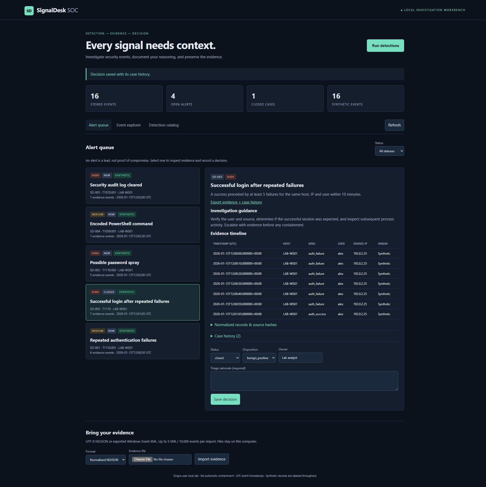
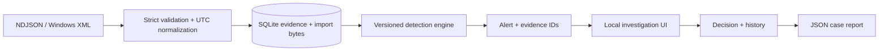

# SignalDesk SOC

**A local security event investigation workbench: ingest → detect → investigate → document.**

SignalDesk turns imported security events into explainable alerts with evidence timelines, analyst decisions, and downloadable case reports. It runs on your computer with Python, FastAPI and SQLite. No cloud account or paid service is required.



## Quick start

Python 3.11+ and Git are required. In PowerShell:

```powershell
git clone https://github.com/ManOfCulture2003/signaldesk-soc.git
cd signaldesk-soc
py -3 -m venv .venv
.\.venv\Scripts\python.exe -m pip install -e ".[test]" -c requirements-lock.txt
.\.venv\Scripts\python.exe -m pytest -q
.\.venv\Scripts\python.exe -m signaldesk.cli demo
.\.venv\Scripts\python.exe -m signaldesk.cli serve
```

Open **http://127.0.0.1:8766**. The demo imports **16 synthetic events** and produces **5 alerts**. Rerunning it produces no duplicate events or alerts. Press Ctrl+C in the terminal to stop the server. On Linux/macOS use `python3 -m venv .venv` and `.venv/bin/python` in place of the Windows executable.

The browser interface and its assets work without an internet connection after dependencies are installed. The ATT&CK reference links require internet access. The application does not automatically contact those sites.

## What works

- Strict normalized NDJSON and Windows Security Event XML imports (4624, 4625, 4688, 1102).
- UTC normalization, content-based event IDs, duplicate suppression, original import bytes and SHA-256 provenance.
- Five versioned, deterministic detections with explicit thresholds, evidence and triage guidance.
- Event search with exact host/user/IP/kind filters and pagination.
- Alert investigation with full normalized records and source hashes.
- New → investigating → closed workflow; true-positive, false-positive and benign-positive dispositions.
- Required rationale, owner field, persistent history and optimistic concurrency checks.
- JSON case export through browser or CLI; CLI export refuses to overwrite an existing file.
- Automated positive/negative, boundary, parser, replay, API and workflow tests.

## Detections

| Rule | Signal | Correlation | ATT&CK reference |
| --- | --- | --- | --- |
| SD-001 | Repeated authentication failures | ≥5 / same host, IP, user / fixed 5-minute UTC bucket | T1110.001 |
| SD-002 | Possible password spray | ≥5 distinct users / same host and IP / fixed 5-minute bucket | T1110.003 |
| SD-003 | Success after repeated failures | ≥5 preceding failures / same host, IP, user / 10-minute lookback | T1110 |
| SD-004 | Encoded PowerShell command | PowerShell or pwsh plus an encoded-command switch | T1059.001 |
| SD-005 | Security audit log cleared | Explicit audit-cleared event | T1070.001 |

These are investigation leads, not proof of compromise. A mapping to ATT&CK describes the behavior being investigated; it does not establish complete technique coverage. See [detection design and limitations](docs/DETECTIONS.md).

## Use your own logs

Use a separate database for real evidence:

```powershell
.\.venv\Scripts\python.exe -m signaldesk.cli --db data\investigation.sqlite ingest your-events.ndjson
.\.venv\Scripts\python.exe -m signaldesk.cli --db data\investigation.sqlite detect
.\.venv\Scripts\python.exe -m signaldesk.cli --db data\investigation.sqlite serve
```

The UI can also import files. Importing does **not** silently run detection: click **Run detections** afterward. All records are validated before a transaction commits. An invalid import writes no events. Limits: 5 MiB and 10,000 events per file; 50,000 stored events per database.

Read [the event schema and Windows export procedure](docs/INGESTION.md) before importing. Original files, database contents and case exports can contain sensitive hostnames, accounts, addresses or command lines. Keep them local. Only synthetic fixtures belong in this repository.

## Investigate an alert

1. Select an alert and inspect the ordered evidence timeline.
2. Expand normalized records to inspect the command, source identity and import hash.
3. Follow the rule's guidance. Check benign explanations before reaching a verdict.
4. Set status and owner, write a rationale, and save the decision.
5. Closing requires a disposition. Export the case to retain evidence and decision history together.
6. If late-arriving evidence changes an existing alert, detection reopens it for review and records the reason. Replays that add nothing preserve the decision.

[Example investigation](docs/CASE-STUDY.md) walks through the bundled synthetic scenario. It is a lab record, not a real incident claim.

## Architecture



See [architecture and API](docs/ARCHITECTURE.md), [security boundaries](SECURITY.md), [verification](docs/VERIFICATION.md), and [roadmap](docs/ROADMAP.md).

## Scope

This release is a **single-user local investigation tool**, not an enterprise SIEM or an unattended security service. It has no live agent, multi-user authentication, RBAC, automated containment, alert notifications, Sigma compiler, EVTX binary parser, or cloud integration. Native event XML and normalized logs are supported; a random vendor JSON export is not automatically compatible. No software can guarantee complete detection or a bug-free deployment.
